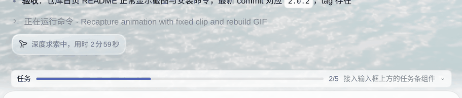
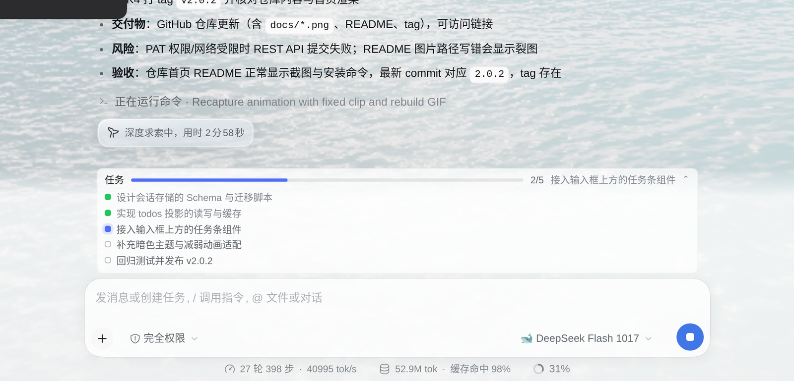
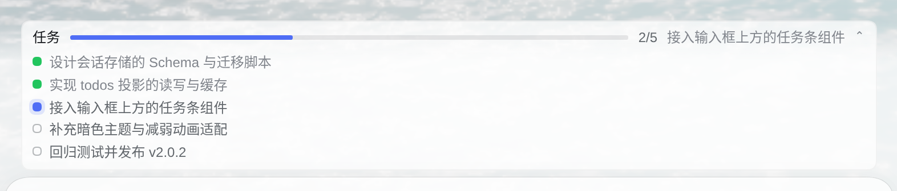
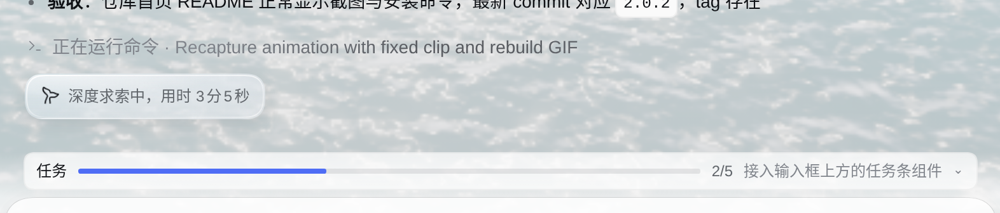

<p align="center">
  
</p>

<h1 align="center">dsh-todo-progress-hud</h1>

<p align="center">
  <b>让 agent 的每一步都看得见。</b><br>
  把 DeepSeek Harness 的任务清单，变成输入框上方一条会呼吸的进度条。
</p>

<p align="center">
  <a href="https://github.com/heisedexiaoniukou-max/dsh-todo-progress-hud/releases"></a>
  
  
  
</p>

<p align="center">
  
</p>

---

## 为什么需要它

Agent 跑长任务时会用 `todo_write` 维护一份清单，但这份清单躺在会话面板里：
没有提示、不显示进度，你得自己点开才知道"它到底做到哪一步了"。

**dsh-todo-progress-hud** 把同一份清单提到输入框正上方——
一条常驻的任务条，进度、当前步骤、每一项的状态，全程可见。

它不产生任何数据，只**读取会话投影**，所以永远和 agent 的 `todo_write` 一致，零配置、零维护。

## 长什么样

<p align="center">
  
</p>

```text
任务  ▓▓▓▓▓▓▓▓░░░░░░  2/5  接入输入框上方的任务条组件            ⌃
● 设计会话存储的 Schema 与迁移脚本
● 实现 todos 投影的读写与缓存
● 接入输入框上方的任务条组件
○ 补充暗色主题与减弱动画适配
○ 回归测试并发布 v2.1.0
```

头部永远可见，展开后是完整清单。点一下整条折叠，再点展开：

| 展开 | 折叠 |
| --- | --- |
|  |  |

## 特性

- **一条就够** —— 直接替换 DSH 内置任务面板（同一个槽位），不会多出一行重复信息
- **进度实时** —— 细进度条平滑过渡，`2/5` 计数跟随，当前步骤自动轮换
- **状态有色** —— 完成转绿、进行中靛蓝并带柔光环、失败转红、待办空心
- **可折叠** —— 点击收起为单行，折叠状态记在 `localStorage`
- **不打扰** —— 无阴影、无浮层、宽度对齐输入框，跟着主题走
- **明暗自适应** —— 暗色模式自动换成更亮的强调色；尊重 `prefers-reduced-motion`
- **失败可见** —— 内容以 `⚠` / `✗` / `❌` 开头即标记为失败，整条边框告警

## 安装

通过 GitHub 安装（跟随默认分支，永远拿到最新版）：

```sh
dsh plugin --profile web add github:heisedexiaoniukou-max/dsh-todo-progress-hud
```

锁定版本（推荐，当前最新 `v2.1.0`）：

```sh
dsh plugin --profile web add github:heisedexiaoniukou-max/dsh-todo-progress-hud#v2.1.0
```

从本地目录安装（开发调试）：

```sh
dsh plugin --profile web add /absolute/path/to/dsh-todo-progress-hud
```

也可以在 DSH 界面里通过 **Settings → Plugins**，或让 agent 调用 `plugin_manager`
的 `install_bundle` 完成安装。装好后刷新页面即可看到任务条。

### 要求

- DeepSeek Harness `>= 0.2.0`（使用 `conversation.input.dock` 插槽）
- 只适用于 Web / Desktop 页面，纯 headless 环境不渲染

## 使用

| 场景 | 行为 |
| --- | --- |
| agent 调用 `todo_write` | 任务条出现并按节点实时点亮 |
| 点击任务条 | 折叠 / 展开完整清单（状态会被记住）|
| 全部完成 | 计数显示「全部完成」，整条边框转绿 |
| 节点失败 | 红色边框 + 红色状态点，进度不会假装正常 |

失败节点的约定写法（agent 侧）：

```text
todo_write([
  { content: "K1 定位问题", status: "completed" },
  { content: "⚠️ K3 联调（接口 500）", status: "in_progress" },
  { content: "K4 回归", status: "pending" }
])
```

## 实现要点

| 项 | 说明 |
| --- | --- |
| 挂载点 | `conversation.input.dock`，占用内置的 `todo` 单元格（替换而非新增）|
| 数据来源 | 会话投影 `todos`（`useProjection`），无网络请求、无持久化 |
| 换行重置 | 主机在每次 `turn/start` 清空投影，插件按会话缓存上一份非空清单，避免闪烁 |
| 样式 | 仅使用 `--dsw-alias-*` 主题变量；尺寸用 `em` 与 `--dsh-content-font-size` 自适应 |
| 依赖 | 无。单个 `client.js`，不打包、无构建步骤 |

## 权限与副作用

- 不需要任何工具权限、网络权限或 Host 服务
- 唯一持久化数据：`localStorage` 的 `todo-progress-hud:collapsed`（折叠偏好）与
  `todo-progress-hud:motion`（设为 `full` 可在系统「减少动画」时强制开启动效）
- 没有 Todo 的会话不渲染任何内容

## 卸载

```sh
dsh plugin --profile web remove dsh-todo-progress-hud
```

## 开发

```sh
git clone https://github.com/heisedexiaoniukou-max/dsh-todo-progress-hud.git
cd dsh-todo-progress-hud
node --check client.js          # 语法校验
dsh plugin --profile web add "$PWD"
```

`client.js` 通过 `window.__ModuleLoader__.load({ id, factory })` 注册，改完刷新页面即可生效。
插件内置构建标记：控制台执行 `window.__TP_HUD` 可确认浏览器实际加载的版本。

```text
dsh-todo-progress-hud/
├── package.json         # dsh.bundle.patch + dsh.client 清单
├── cordis.patch.yml     # 插入 Host 行
├── index.js             # Host 半边（空实现）
├── client.js            # 浏览器半边：唯一一个插槽座位
├── docs/                # README 截图与动图
├── locale/{zh,en}.json  # 商店展示元数据
└── icon.svg
```

## 许可

[MIT](./LICENSE) © heisedexiaoniukou-max
